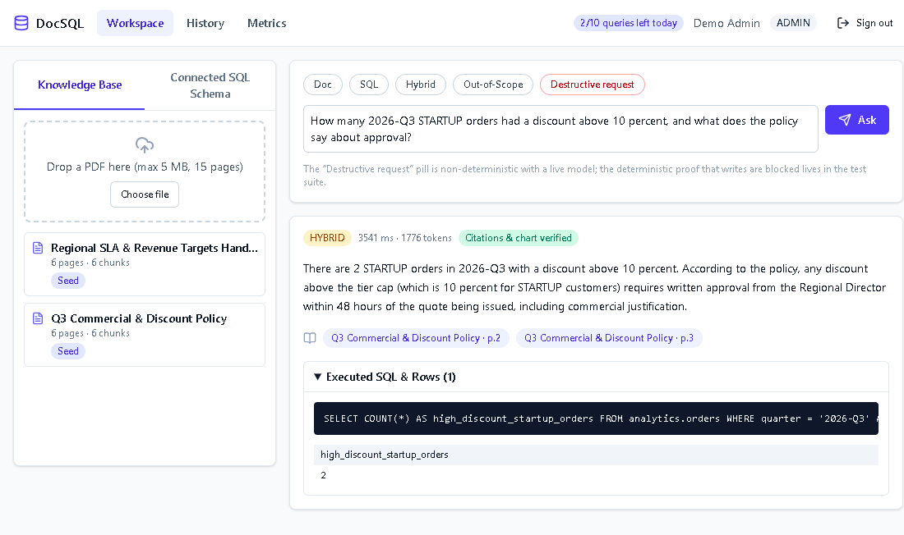
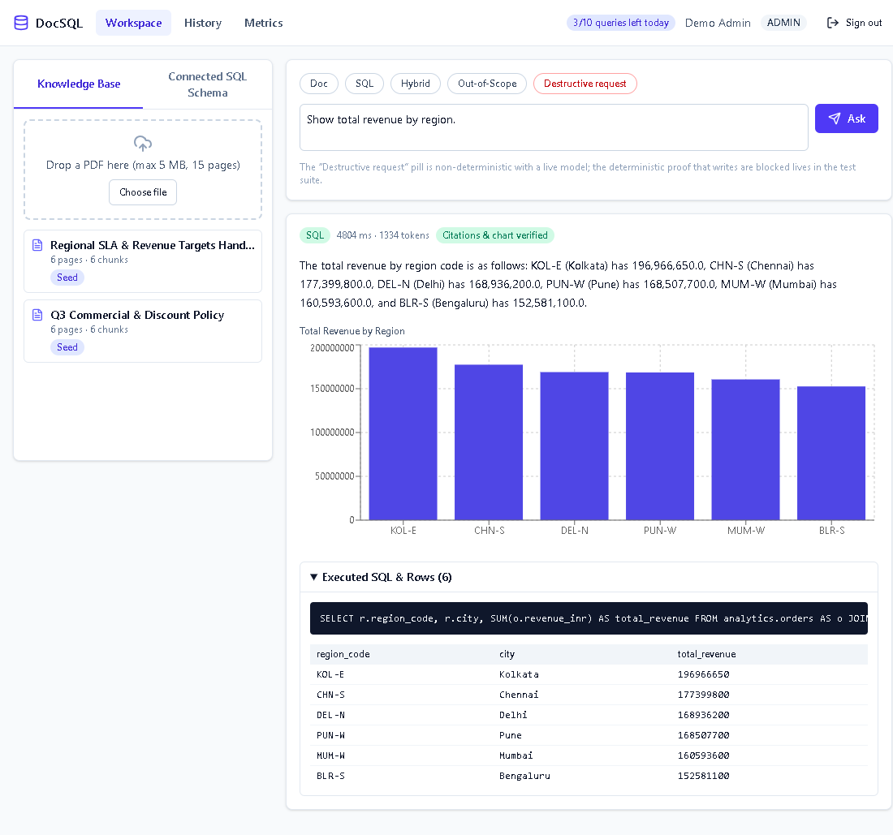
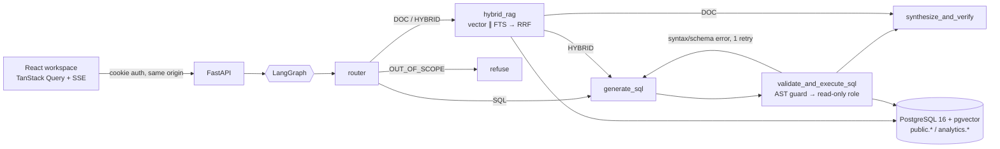

# DocSQL

[](https://github.com/sooryasv/docsql/actions/workflows/ci.yml)

Ask one question and get an answer grounded in **your PDFs**, **a read-only SQL database**, or **both** — with every claim traceable (clickable citations, executed SQL, and rows) and a security model backed by real-Postgres tests.

**Live demo:** [https://docsql.sooryasv.me](https://docsql.sooryasv.me) *(1-click **Demo Admin** → try the **SQL** and **Hybrid** sample pills → inspect `/metrics`; bounded by daily quotas and Cloudflare WAF)*

**Stack:** Python 3.12, FastAPI, LangGraph, `google-genai`, `sqlglot`, async SQLAlchemy 2 + `asyncpg`, Alembic, PostgreSQL 16 (`pgvector 0.8.7` + FTS), React 19 + TypeScript (`strict`), Vite, Tailwind 4, TanStack Query, Recharts, Docker. Deployed on AWS Lightsail Containers + private Amazon ECR + pooled Neon Serverless Postgres + Cloudflare TLS/WAF.



<details>
<summary>More preview: SQL query with verified Recharts visualization</summary>



</details>

## Why this is interesting

| Problem | What DocSQL does |
|---|---|
| LLM-written SQL is an injection vector | Two independent layers: a `sqlglot` **AST class allowlist** (executes *only* the re-emitted SQL) and a **PostgreSQL role** that can only `SELECT` from `analytics.*`, in a `READ ONLY` transaction with a statement timeout. Either layer alone stops the tested attacks; the tests prove each in isolation. |
| Multi-tenant vector search silently returns too little | Filtered HNSW search starves without `hnsw.iterative_scan`. The test suite **reproduces the failure** (negative control) and proves `strict_order` fixes it. |
| RAG answers cite things they never read | Citations and chart columns are verified **deterministically** against what was actually retrieved/returned. Fabricated chunk IDs are dropped; a document answer with no valid citation becomes a refusal. |
| Prompt injection inside PDFs | Retrieved text is wrapped in per-request random-nonce tags, any attempt to forge the tag is stripped, and **PDF text never reaches the SQL generator** (HYBRID isolation). |
| "Streaming" that hides what is happening | Stage-progress SSE (`routing → retrieving_docs → generating_sql → validating_sql → executing_sql → verifying_output`) with `: ping` heartbeats, a request deadline, and cancellation of in-flight LLM calls on client disconnect. |

## Architecture



Details: [`docs/ARCHITECTURE.md`](docs/ARCHITECTURE.md) · decisions: [`docs/DECISIONS.md`](docs/DECISIONS.md).

## Measured security properties (real Postgres + pgvector, `pytest`)

| Property | How it is shown |
|---|---|
| 25 adversarial SQL payloads blocked by the guard (DDL/DML, multi-statement, writable CTE, recursion, comma/cross/`ON 1=1` joins, catalog and `public.*` access, `pg_sleep`/`dblink`/`pg_read_file`, `UNION`, parameters, windows, oversize) | `tests/test_sql_security.py` (+ 9 extra payloads); `python -m evals.run_eval` prints the block rate |
| Realistic analytics SQL is **not** over-blocked (`CASE`, `COUNT(DISTINCT)`, `::numeric`, `EXTRACT`, CTE, 3-way join, `AND`/`OR`) | positive set in the same file |
| The DB role alone stops reads of `public.users` and writes, with the guard bypassed; **negative control**: the app role can do both | role-bypass tests |
| `statement_timeout` kills `pg_sleep(5)` on the raw read-only engine | role-bypass tests |
| Syntax/schema error → exactly **1** retry; security violation → **0** retries and the error text never reaches the LLM | retry-taxonomy tests (assert on the mock call log) |
| Filtered HNSW search needs `iterative_scan` (**control** returns 0 rows without it) | `test_hnsw_filtered_search_needs_iterative_scan` |
| Per-user document isolation; seed docs visible, undeletable; cross-tenant access → 404 | IDOR matrix in `tests/test_auth_documents.py` |
| 20 parallel queries against a limit of 5 → exactly 5 succeed; a failed global check rolls back the user's increment | atomic-quota tests |
| Hostile chunk cannot close the nonce tag and never reaches `generate_sql` | hostile-PDF test (+ control) |

Run them yourself: [`docs/LOCAL_VERIFICATION.md`](docs/LOCAL_VERIFICATION.md).

## Evaluation (measured live Gemini baseline)

`backend/evals/run_eval.py` runs 30 golden questions (10 DOC, 10 SQL, 5 HYBRID, 5 OUT_OF_SCOPE) plus the 25-payload offline SQL guard suite (`gemini-3.5-flash-lite` + `gemini-embedding-001`, single run, temperature 0). Full table and threshold sweep: [`docs/EVAL_REPORT.md`](docs/EVAL_REPORT.md).

| Metric | Measured Result |
|---|---|
| Adversarial SQL guard block rate | **25/25 (100%)** |
| Routing accuracy | **30/30 (100%)** *(4 transient Gemini `503`s recovered via backoff)* |
| Doc retrieval `hit@5` / Required-fact recall | **15/15 (100%)** / **15/15 (100%)** |
| Refusal accuracy (OOS) / False-refusal rate | **5/5 (100%)** / **0/25 (0%)** |
| Pre-filter invalid-citation rate → Post-filter integrity | **0/17 (0%) → 30/30 (100%)** *(down from `26%` pre-tuning; deterministic gate retained)* |
| SQL execution accuracy (strict `gold_sql` match) | **14/15 (93%)** *(single miss `g19` returned exact `['CHN-S']` without unrequested revenue col)* |
| Latency p50 / p95 | **3,504 ms / 6,798 ms** |

Based on the `--sweep` calibration (`15/15` recall preserved up to `0.50`), production runs with `MIN_COSINE_SIMILARITY=0.50`. To re-run against a live key (use `--delay 10` on free-tier RPM limits):

```bash
cd backend && MOCK_LLM=false GEMINI_API_KEY=... python -m evals.run_eval --sweep --delay 10 --out ../docs/EVAL_REPORT.md
```

## Quick start

```bash
cp .env.example .env
docker compose up --build          # Postgres(pgvector) + migrations + API + built SPA on http://localhost:8000
```

Mock mode (default) needs no API key. For a live model set `MOCK_LLM=false`, `GEMINI_API_KEY`, and verify
`GEMINI_CHAT_MODEL` against Google's current deprecations page (model IDs are env-driven).

Local development without Docker for the app: [`docs/runbook.md`](docs/runbook.md).
Sign in with **Demo analyst / Demo admin** (no password). The metrics page is admin-only.

> The “Destructive request” sample pill is **non-deterministic with a live model** (the model may refuse, or emit a write
> that the guard then blocks). The deterministic proof that writes are blocked lives in the test suite.

## Repository layout

```text
backend/app/    api/ · services/ (sql_guard, sql_executor, rag_service, agent_graph, query_service, usage_service)
backend/        alembic/ · tests/ (test_sql_security, test_rag_graph_sse, test_auth_documents) · evals/ (run_eval, dataset.json)
frontend/src/   api.ts · api.test.ts · components/ · pages/
docs/           ARCHITECTURE · DECISIONS · EVAL_REPORT · LOCAL_VERIFICATION · SPEC · runbook
infra           Dockerfile · docker-compose.yml · docker/init-roles.sql · .github/workflows/ci.yml
```

## Verification & production engineering

- **Automated gates:** `ruff` (lint + format), `mypy --strict`, **110 backend tests** against real PostgreSQL 16 + `pgvector` (never SQLite), **25/25** offline SQL guard check, ESLint, `tsc --noEmit`, **11 Vitest frontend tests**, and multi-stage Docker build (GitHub Actions CI: `backend`, `frontend`, `docker`).
- **Cloud & serverless hardening:** Separate `/livez` (zero-DB liveness probe for AWS Lightsail so Neon scales to zero) vs. `/healthz` (deep readiness check on both pools + `pgvector >= 0.8.0`); `docsql_readonly` created via raw SQL (avoiding Neon Console superuser inheritance) and verified live against unauthorized reads/writes; Cloudflare Full (strict) TLS, Bot Fight Mode, and WAF rate limiting (`15 req / 10s` per IP on cost-bearing API routes).
- **Verified live:** End-to-end on desktop and mobile at [https://docsql.sooryasv.me](https://docsql.sooryasv.me).

## Known Limitations

- Answer **text** is not semantically verified; only citations and chart columns are (referential integrity).
- Injection defenses are layered mitigations, **not guarantees**. The guard's residual risk (e.g. a column-bearing but
  weak `JOIN … ON` predicate) is bounded by the read-only role, row cap and timeout (ADR-002).
- PDFs must contain extractable text (no OCR); 5 MB / 15 pages max.
- HNSW is unnecessary at this data scale; it is used to demonstrate filtered-ANN correctness.
- Small, single-run, temperature-0 eval; no confidence intervals.
- Quota counts *attempts* (consumed before the LLM runs); mock mode disables quotas.
- A PDF parse that times out is abandoned in its thread, not killed.
- Generated SQL is limited to a single `SELECT` (CTEs allowed) without window functions or set operations; `EXISTS` and
  array constructs are also rejected by the function allowlist.
- Demo login is disabled for private enterprise deployments (`ENABLE_DEMO_TOOLS=false`). On the public portfolio demo
  (`docsql.sooryasv.me`), it is intentionally enabled for 1-click evaluation and bounded by four guardrails: atomic
  PostgreSQL per-user (`10/day`) and global (`80/day`) quotas, read-only admin telemetry (ADR-008), Cloudflare Bot Fight
  Mode + edge WAF rate limiting (`15 req / 10s` per IP on `/api/v1/query`, `/api/v1/documents`, `/api/v1/auth/demo-login`),
  and a free-tier Gemini API key ceiling.
- Free-tier LLM limits and model retirements may require a model-ID change (`GEMINI_CHAT_MODEL` env var).
